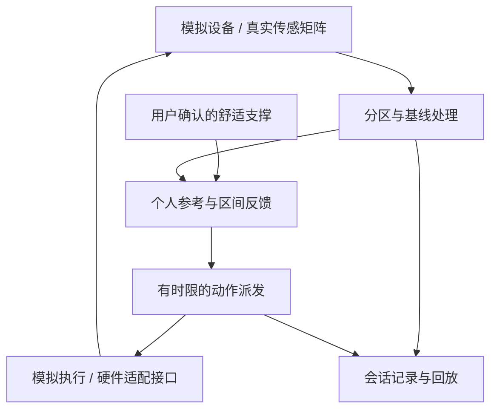

<div align="center">

# LumbarOS

### 让支撑跟上身体。

**面向主动腰部支撑的自适应触觉系统**  
Adaptive Tactile Intelligence for Active Lumbar Support

**WTCC 2026 · Hack for Life · Live Track Winner**

[实物与现场](docs/WTCC_2026.md) · [系统架构](docs/ARCHITECTURE.md) · [硬件交接](HANDOFF.md) · [物料清单](hardware/README.md) · [验证记录](docs/verification.md)

</div>

<p align="center">
  
</p>

## 从一块腰靠，到持续反馈的支撑系统

坐着工作时，身体始终在变化：向前取物、向后倚靠、改变坐深，或者只是轻轻移动。LumbarOS 围绕一个具体目标展开：**记住使用者认可的接触状态，让活动腰托在身体变化后重新找到合适的支撑区间。**

本轮成果包括剪式伸缩实物样机、触觉采集固件、电脑端实验台、个人参考与反馈控制、实验记录和现场展示。项目在 **WTCC 2026 创客松**获得 **Live Track Winner**，现场公示奖励为 **¥5,000 + 1,000 Token**。

仓库保存本轮实际代码、硬件交接资料、物料卡、演示视频与现场照片。

## V1 实物

<p align="center">
  
  
</p>

**单推杆驱动剪式伸缩机构，使同一块腰托整体前顶、回退与停止。** 触觉采集用于观察人与支撑面的接触变化，电脑端实验台用于建立个人参考、观察控制决策和保存调节过程。

- [椅上样机演示 · 43 秒](assets/demo/demo-01.mp4)
- [桌边机构演示 · 20 秒](assets/demo/demo-02.mp4)
- [全部现场照片与原始视频](docs/WTCC_2026.md)
- [15 种零件、31 件的原型物料记录](hardware/README.md)

## 本轮技术交付

| 模块 | 已交付内容 |
| --- | --- |
| **触觉采集** | Nano / Uno 的 16×16 ViTac 采集参考固件，JSON 串口帧，原始版本与修正版 |
| **设备层** | 帧格式检查、重复与倒序处理、数据新鲜度、空载归零、矩阵显示 |
| **八区聚合** | 根据配置中的矩阵索引计算区域均值，检查缺区与重复索引 |
| **个人支撑参考** | 采集约 3 秒稳定接触，保存各区均值、波动与参考范围 |
| **反馈控制** | 个人参考驱动的带滞回区间反馈、持续判定、小段动作与停稳间隔 |
| **执行器接口** | 统一派发、动作去重、到期停止、发送与接收状态、故障锁存 |
| **电脑端实验台** | 八区示意、压力曲线、16×16 矩阵、手动微调、自动开关、场景模拟与参数设置 |
| **实验记录** | 输入帧、个人参考、控制参数、动作与体验反馈记录，JSON 下载与时间轴回放 |
| **交接与验证** | 完整源码、接入模板、协议说明、验收步骤与 97 项软件测试 |

**接入状态：**模拟闭环可直接运行。真实传感矩阵已有接入代码；`config/zones.json` 保留为空，等待按实际布面逐区标定。真实执行器通过适配器接入，当前交付模板仍待实现电机协议、实际运动反馈与板端保护。现场实物展示与这份软件包的验证范围分别记录在[现场记录](docs/WTCC_2026.md)和[硬件接手说明](HANDOFF.md)中。

## 核心算法：先记住舒服，再维持接触

V1 使用 **个人参考 + 带滞回的区间反馈 + 状态机**。

1. 使用者找到认可的支撑状态，点击“记住当前支撑”。
2. 系统采集稳定读数，记录个人参考与自然波动。
3. 接触持续偏弱时，生成一次有时限的前顶动作；偏强时回退；区间内保持。
4. 动作后留出停稳时间，再用新读数进入下一轮判断。
5. 用户接管时退出自动；接触丢失、读数失效或掉线时，停止并暂停自动。

腰部三个反馈点对应 **5、6、7 区**。控制器同时检查平均接触和局部偏强，避免平均值掩盖局部腰区偏强。**1–4 区**用于入座判断，**8 区**用于显示与记录；三个腰部测点共同控制一个前后运动自由度。

| 接触情况 | 控制行为 |
| --- | --- |
| 持续偏弱，且没有局部偏强 | 受限前顶 |
| 整体或局部持续偏强 | 受限回退 |
| 处于个人参考区间 | 保持 |
| 整体偏弱，局部偏强但未达到回退阈值 | 保持，提示调整 |
| 离座、脱离接触、掉线或无效数据 | 停止并暂停，等待明确重新开启 |

### 技术难点：人的动作和腰托的动作都会改变压力

同一次读数变化，可能来自身体移动，也可能来自腰托运动。因此，系统将**接触信号、控制状态、动作时限和反馈记录**放在同一个过程里观察。

本轮实现保留动作前后的读数，用持续判定和停稳间隔处理短时波动，以统一派发链管理自动调节、手动微调和停止。完整实现见 [controller.py](lumbar/controller.py)、[actuators.py](lumbar/actuators.py) 与 [service.py](lumbar/service.py)。



[查看系统架构与模块分工](docs/ARCHITECTURE.md)

## LumbarLab 电脑端实验台

<p align="center">
  
</p>

实验台保留 **LumbarLab** 界面名称，作为 LumbarOS 的控制与验证工作台。上图展示模拟模式下的八区信号、个人参考与手动控制。

<details>
<summary>查看自动跟随演示画面</summary>

<p align="center">
  
</p>

此图记录自动跟随的模拟状态，便于对照控制决策、参考区间与动作输出。

</details>

## WTCC 2026 · 从演示到现场交流

<p align="center">
  
  
</p>

<p align="center">
  
  
</p>

这一轮保留了产品实物、参与者体验、专家与投资者问答、团队演示和颁奖记录。完整相册收录 **9 张现场照片、3 张实物演示图和 3 个视频文件**；其中两个椅上演示视频为同一拍摄片段的不同文件版本。

[打开完整现场记录](docs/WTCC_2026.md)

## 运行本轮 Demo

需要 **Python 3.10 或更新版本**。模拟模式仅使用 Python 标准库，无需安装前端构建工具。

```bash
git clone https://github.com/niuniuyyds52985/LumbarOS.git
cd LumbarOS
python run.py
```

浏览器访问 **http://127.0.0.1:8765/**。macOS / Linux 可将 `python` 换成 `python3`；Windows 也可运行 `start_windows.bat`。

**第一次体验：**

1. 保持“自然坐姿”，点击“记住当前支撑”。
2. 等待参考采集完成，开启“自动跟随支撑”。
3. 切换“身体前倾”或“身体后靠”，观察接触、动作与模拟位置。
4. 开始记录，留下“偏弱／刚刚好／偏强”反馈，保存后打开回放。
5. 切换“信号掉线”，观察自动暂停与恢复后的状态。

连接串口前安装可选依赖：

```bash
python -m pip install -r requirements-serial.txt
```

硬件接手从 [HANDOFF.md](HANDOFF.md) 开始，具体协议和适配方式见[接入指南](docs/HARDWARE_INTEGRATION.md)。默认串口模式用于采集与观察，真实动作需由已经实现并验证的适配器执行。

## 验证

```bash
python -m unittest discover -s tests -v
```

**2026-10-27 复核：97 项测试及其中 76 个子测试全部通过。**

覆盖个人参考、反馈状态、模拟耦合、串口帧解析、归零、命令去重与到期、故障处理、记录回放数据、HTTP 接口和硬件扩展入口。该结果对应软件与测试替身；固件编译烧录、实物映射和真实执行器联调见交接文档中的待完成项。

[查看详细验证记录](docs/verification.md)

## 仓库导航

| 路径 | 内容 |
| --- | --- |
| [lumbar/](lumbar/) | 控制器、设备层、动作派发、服务与模拟器 |
| [web/](web/) | 电脑端界面 |
| [firmware/](firmware/) | ViTac 采集修正版与原始固件 |
| [integrations/](integrations/) | 真实执行器接入模板 |
| [config/zones.json](config/zones.json) | 待实测填写的八区映射 |
| [tests/](tests/) | 本轮软件回归测试 |
| [hardware/](hardware/) | 原型物料表与原始图文卡片 |
| [assets/](assets/) | 现场照片、实物视频与软件截图 |
| [docs/](docs/) | 架构、协议、接入、验收与现场记录 |
| [archive/](archive/) | 10 月 23 日 Demo 与 10 月 24 日原始硬件交接包 |

代码、文档与媒体的权利说明见 [NOTICE.md](NOTICE.md)。

**V2 计划在本轮结束约两个月后推进数据与模型驱动的个体化支撑，并加入呼吸灯交互。**
