# WTCC 2026 · 现场记录

LumbarOS V1 在 **WTCC 2026 创客松 · Hack for Life** 进行了样机展示、参与者试坐和现场交流。本页保留本轮原始素材，连接产品、代码与现场工作。

## Live Track Winner

颁奖屏与奖牌显示：**Live Track Winner 奖，1 队，¥5,000 + 1,000 Token 奖励**。

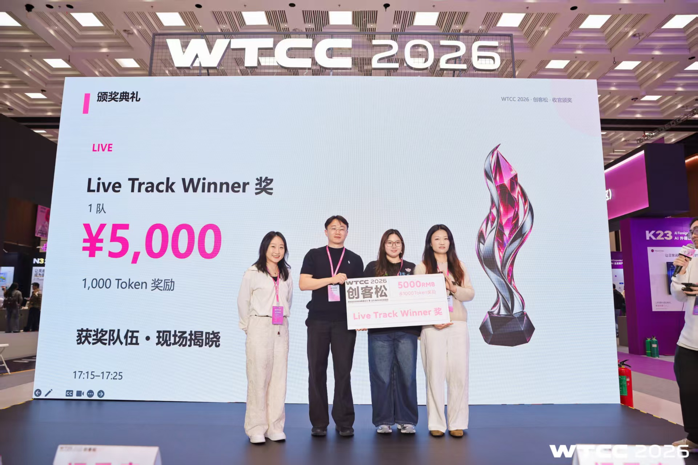

另一角度的颁奖记录

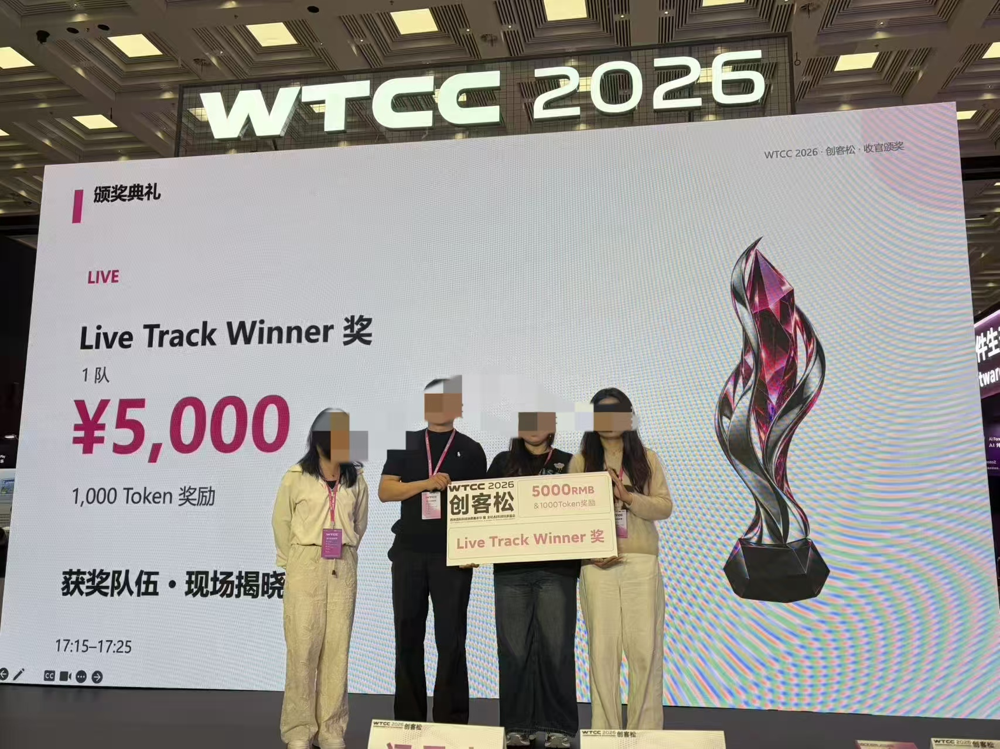

## 实物样机与演示视频

| 素材 | 内容 |
| --- | --- |
| [椅上样机演示](../assets/demo/demo-01.mp4) | 43.37 秒，展示安装在办公椅上的活动腰托与连接结构 |
| [桌边机构演示](../assets/demo/demo-02.mp4) | 20.50 秒，展示人员操作样机的过程 |
| [椅上演示的另一文件版本](../assets/demo/demo-03.mp4) | 43.37 秒，与第一段为同一拍摄片段的不同文件版本 |

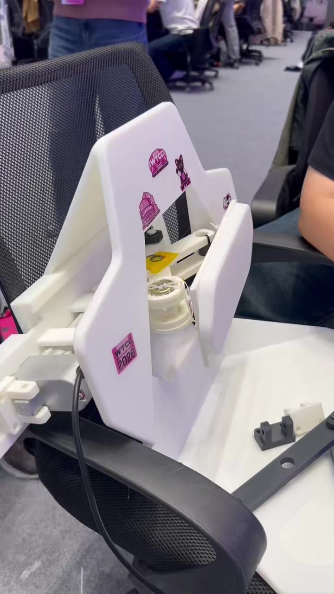

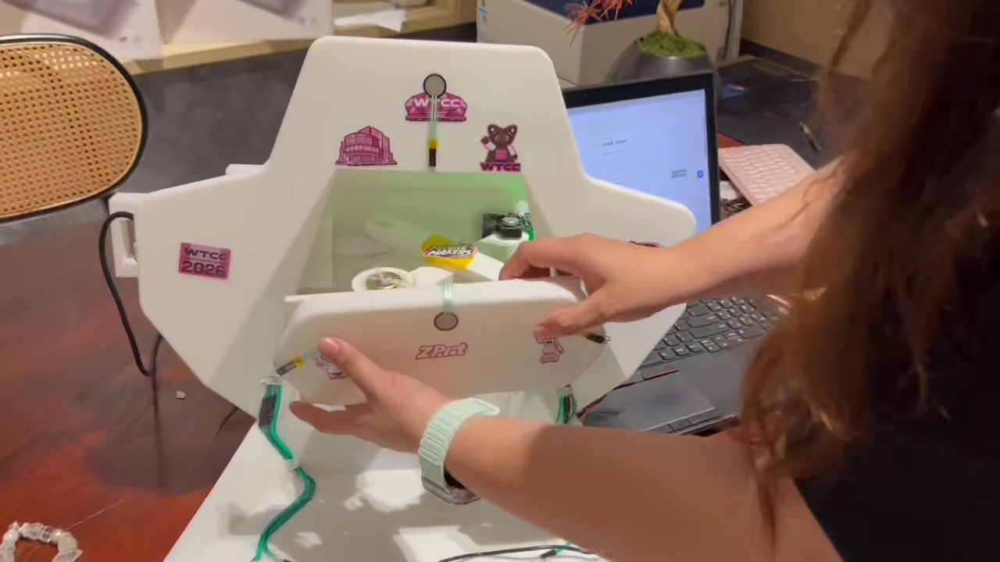

原始实物演示补充图

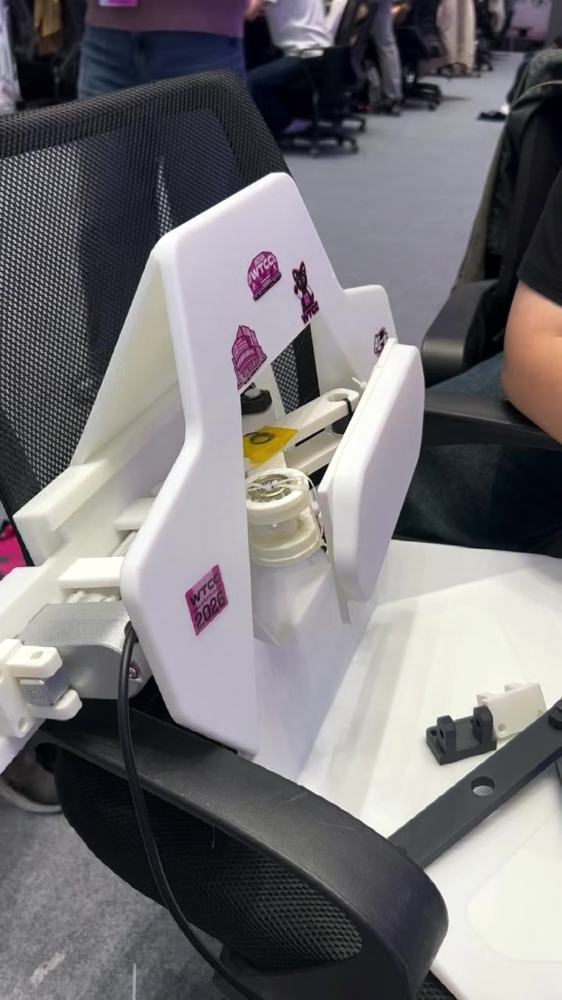

视频和照片记录实物形态与演示现场。该软件包的可复现验证及真实驱动接入状态见[验证记录](verification.md)与[硬件接手说明](../HANDOFF.md)。

## 专家与投资者问答

以下场景名称沿用项目团队对原始照片的说明。

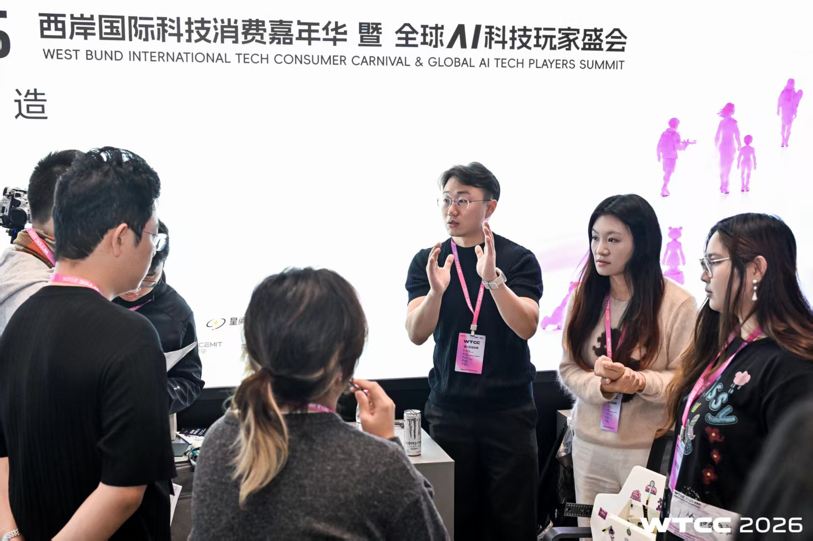

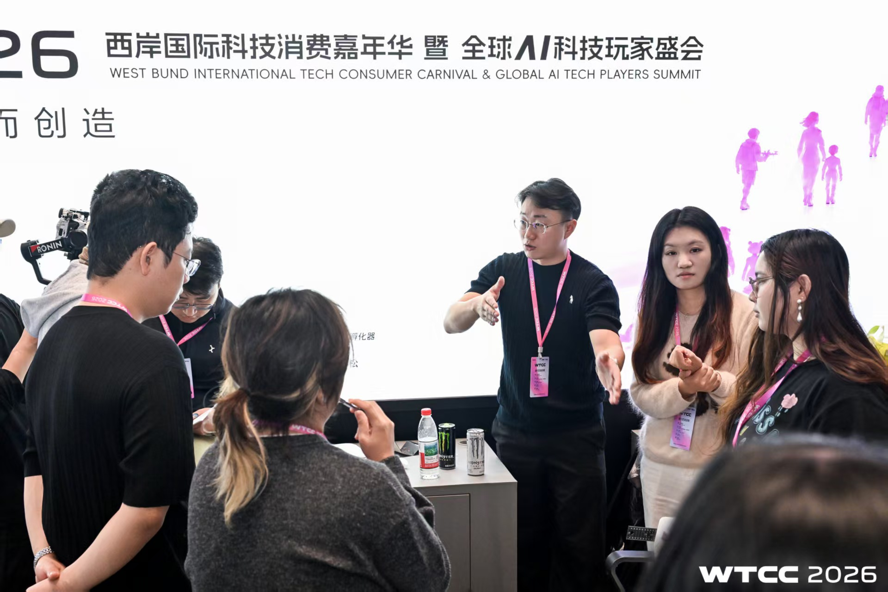

## 参与者体验

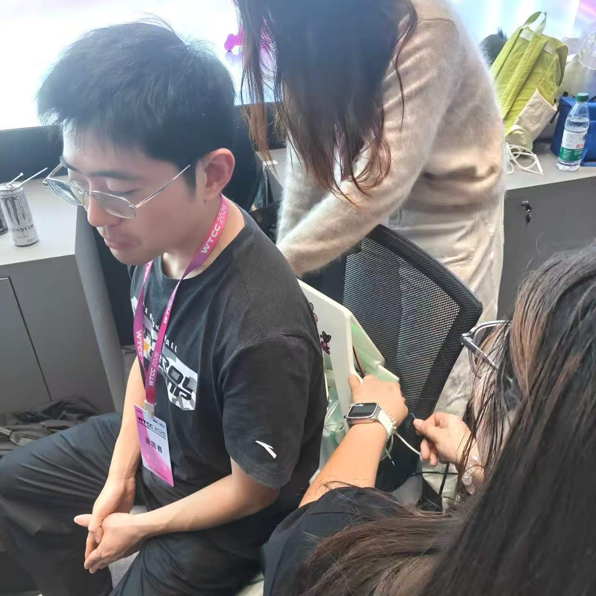

## 团队演示与合影

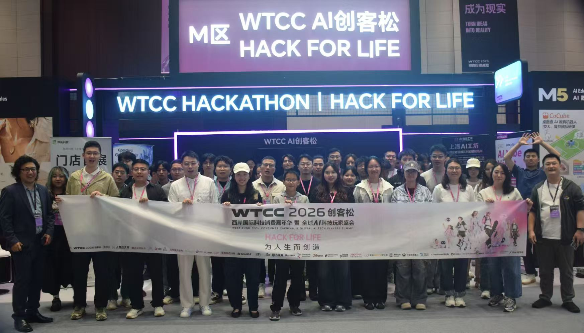

## 软件演示画面

以下两张为 **LumbarLab 模拟工作台**截图。

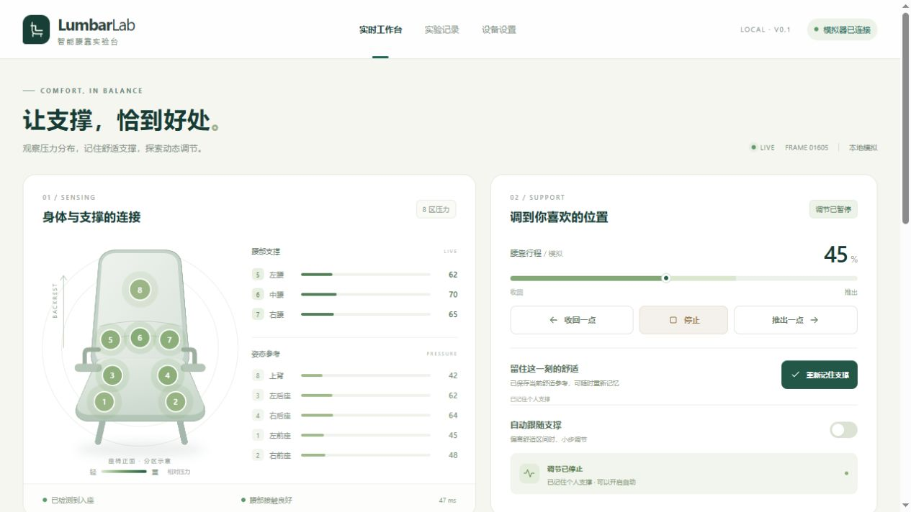

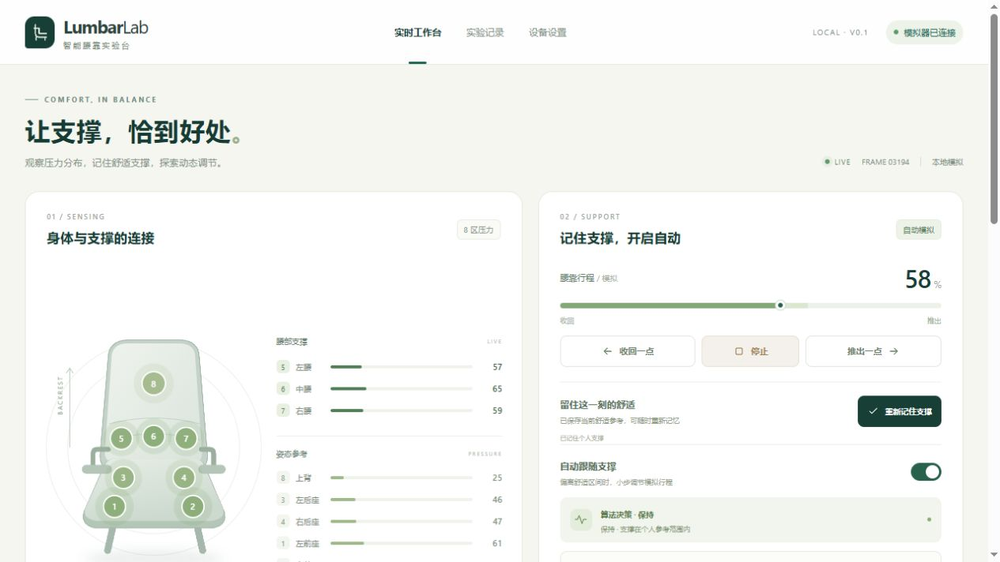

[返回项目主页](../README.md)
